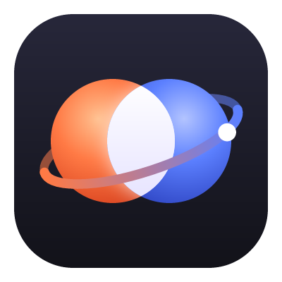
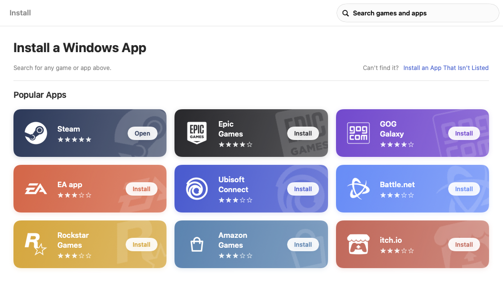
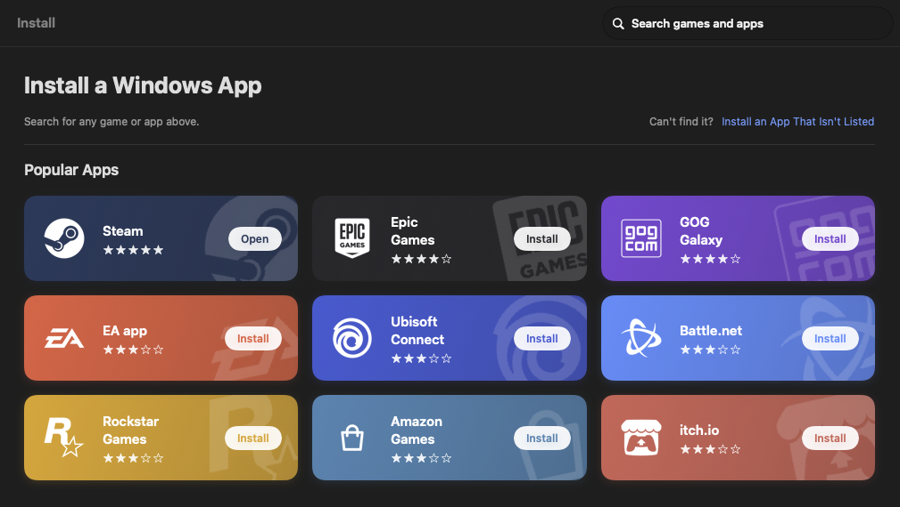
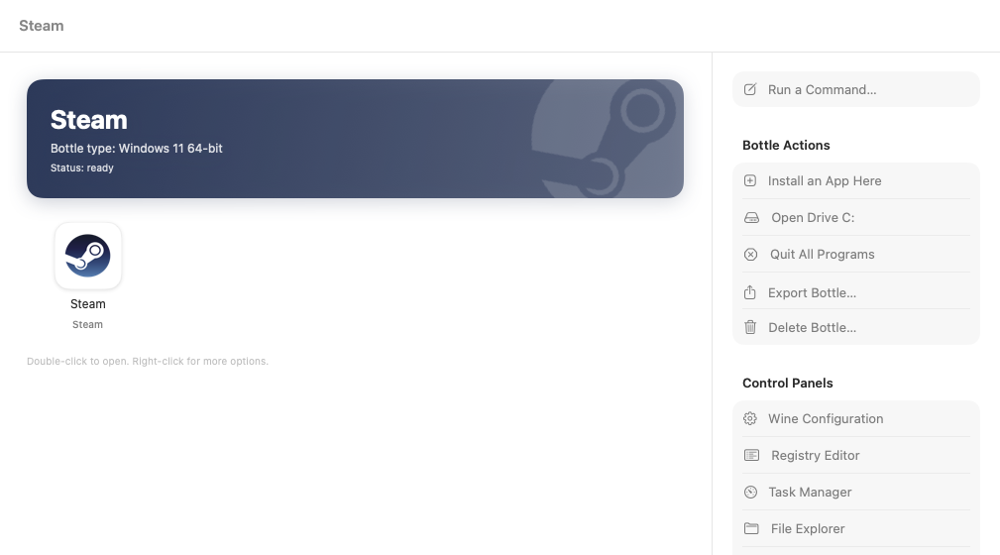
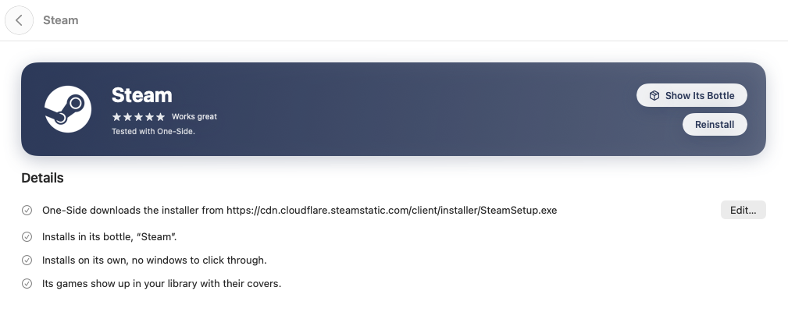
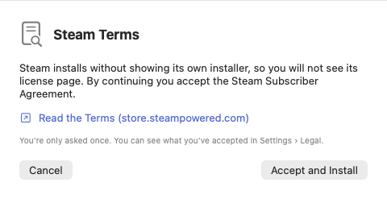
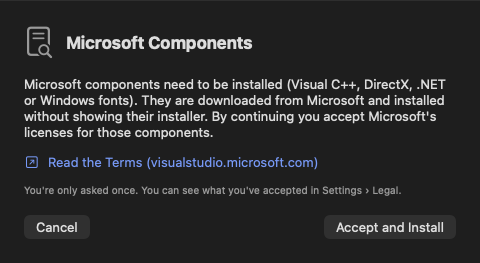
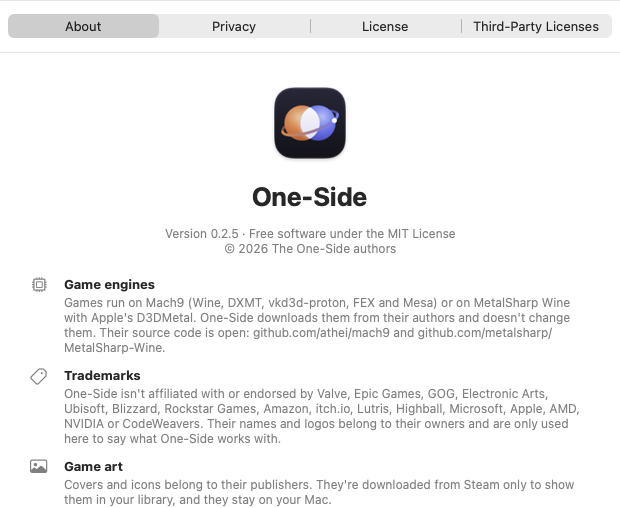

<div align="center">



</div>

<h1 align="center">One-Side</h1>

<div align="center">

[](https://developer.apple.com/xcode/swiftui/)
[](https://www.rust-lang.org/)
[](https://doc.rust-lang.org/cargo/)
[](https://www.winehq.org/)
[](https://github.com/athei/mach9)
[](https://www.apple.com/macos/)

</div>

<div align="center">
 <p><i>A native Mac launcher for Windows games and apps on Apple silicon, built with Rust and SwiftUI.</i></p>
</div>

[](https://git.io/typing-svg)

<table>
 <tr>
  <td width="50%"></td>
  <td width="50%"></td>
 </tr>
 <tr>
  <td width="50%"></td>
  <td width="50%"></td>
 </tr>
</table>

Every install gets its own **bottle** (a separate Windows) and shows up in your library with its cover. Steam, Epic Games, GOG, EA app, Ubisoft Connect, Battle.net, Rockstar Games, Amazon Games and itch.io install in one click from their official installers, and Epic Games and GOG games can be played without their launchers.

[](https://git.io/typing-svg)

Games run on [Mach9](https://github.com/athei/mach9): native ARM64 Wine, FEX for x86 code, DXMT for DirectX 10/11, mtld3d for DirectX 9 and vkd3d-proton with KosmicKrisp for DirectX 12 and Vulkan, all on Metal. One-Side downloads it from its authors the first time. Each game can use **Auto**, **Metal** or **WineD3D**. Auto picks the right layer for the game and falls back to WineD3D by itself if the game closes on Metal. Games that ship both DirectX 11 and 12 can be told to use DirectX 11 on DXMT, and Auto does it for the ones known to work that way. DirectX 12 reaches feature level 12_0 without ray tracing or mesh shaders, so games that need DirectX 12 Ultimate do not start yet. Each game also shows how it runs on Apple silicon, and games whose kernel anti-cheat cannot work in Wine are flagged before you download or start them, using the open [highball-db](https://github.com/gauthierpiarrette/highball-db) (CC0).

[](https://git.io/typing-svg)

A bottle can also run on Apple's **D3DMetal** (from the Game Porting Toolkit, through [MetalSharp Wine](https://github.com/metalsharp/MetalSharp-Wine) under Rosetta), like CrossOver. Each game or bottle picks **Auto**, **D3DMetal**, **DXMT** or **WineD3D**, and Auto tries the next one by itself if a game closes at start. CrossOver's defaults come along: AVX under Rosetta, MSync, .NET games without W^X, and high resolution at 192 dpi.

- **DLSS** runs on MetalFX.
- **FSR 4 instead of MetalFX:** DLSS games are upscaled with AMD FSR 4.1.2, through [fsr4-native-macos](https://github.com/UzenUPoZiTiV4ik/fsr4-native-macos). One-Side downloads it and builds it on your Mac with the Command Line Tools only, no Xcode needed.
- **OptiScaler** (per game): for games that only have FSR 2/3 or XeSS, [OptiScaler](https://github.com/optiscaler/OptiScaler) hands them to DLSS, so they get MetalFX or FSR 4 too. Turning it off removes exactly the files it added.

[](https://git.io/typing-svg)

<table>
 <tr>
  <td width="50%"></td>
  <td width="50%"></td>
 </tr>
</table>

One-Side never accepts a license for you. Before anything is installed without its own installer (silent store installers, winetricks, Lutris community installers or Microsoft runtimes), you see whose terms apply, with the official link. Installers only come from official websites.

[](https://git.io/typing-svg)

1. Download **`One-Side-macOS-arm64.dmg`** from the newest [release](https://github.com/rhythmcreative/one-side/releases) (One-Side is in beta, so releases are marked as pre-releases).
2. Open it and drag **One-Side** to **Applications**.
3. Open One-Side from Launchpad or Spotlight. The first time, it downloads the Mach9 engine.

After that, One-Side keeps itself and everything it downloads up to date on its own. You can turn that off in **Settings › Updates**.

> [!IMPORTANT]
> The app is not notarized by Apple yet. The first time, macOS says it cannot check it: go to **System Settings › Privacy & Security** and press **Open Anyway**. You only have to do this once.

Needs a Mac with Apple silicon and macOS 14 or later.

[](https://git.io/typing-svg)

Drag **One-Side** from Applications to the Trash. Your bottles, games and settings stay in `~/Library/Application Support/One-Side`, so delete that folder too if you want them gone.

[](https://git.io/typing-svg)

The app ships a small helper used by Dock shortcuts and for testing. To build the app yourself, run `./bundle.sh` (needs [Rust](https://rustup.rs) and `xcode-select --install`).

```bash
❯ /Applications/One-Side.app/Contents/MacOS/one-side --help

  --play <bottle> <game>                Starts a game from the library (Dock shortcuts use this)
  --install <store>                     Installs a store: steam, epic, gog, ea, ubisoft, battlenet, rockstar, amazon, itch
  --install-app wt:<verb> <name>        Installs a winetricks app in its own bottle
  --install-app lutris:<slug> <name>    Installs with a Lutris community installer
  --install-app file:<path> <name>      Installs from your own .exe or .msi
  --winetricks <bottle> <verbs…>        Installs dependencies in a bottle
  --accept                              You accept the terms of what installs without its own installer
  --check-updates                       Updates One-Side and what it downloads, now
  -h, --help                            This help
```

Like the app, the command line never accepts a license for you: without `--accept` it stops and tells you whose terms apply.

[](https://git.io/typing-svg)

<div align="center">

</div>

- One-Side is free software under the [MIT license](LICENSE). Contributions are accepted under the same license.
- Third-party software and its licenses: [legal/THIRD_PARTY_NOTICES.txt](legal/THIRD_PARTY_NOTICES.txt). Privacy (no accounts, no servers, no analytics): [legal/PRIVACY.md](legal/PRIVACY.md). Full legal notes: [legal/LEGAL.md](legal/LEGAL.md).
- One-Side is an independent project. It is not affiliated with or endorsed by Valve, Epic Games, GOG, Electronic Arts, Ubisoft, Blizzard, Rockstar Games, Amazon, itch.io, Lutris, Highball, Microsoft, Apple or CodeWeavers. Their names and logos are trademarks of their owners and are only used to say what One-Side works with. Store logos come from [Simple Icons](https://simpleicons.org) (CC0).
- Game art is fetched from Steam on each Mac and is not part of this repository.
- Provided as is, without warranty. Use every store and game according to its own terms.

<div align="center">
 <p><i>Hope you enjoy it :) </i></p>
</div>
